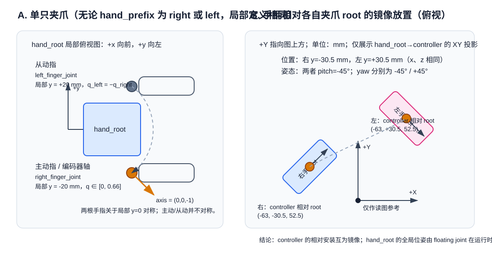

# Galaxis 夹爪左右镜像与主动轴分析

分析对象：[`galaxis_hand.urdf.xacro`](../galaxis_description/urdf/galaxis_hand.urdf.xacro)。本文只根据该 Xacro 与它引用的 STL 网格判断，未假设真实硬件装配方向与 URDF 一定完全一致。



## 结论先说

1. **单只夹爪内部，两根手指是镜像开合的；但只有局部 `right_finger_joint` 是主动关节。** `left_finger_joint` 是它的 mimic 从动关节，角度永远取反。
2. **左右两只夹爪的局部运动学定义完全一样，并没有为左手把主动关节改成 `left_finger_joint`。** 所以“右手的主动轴在右边”时，左手仍由名为 `left_right_finger_joint` 的那根局部 right finger 驱动。
3. **左右 controller 相对各自夹爪 root 的安装是镜像的。** 它们的相对 `y` 坐标相反，yaw 也一正一负。
4. **但该文件并未固定两只夹爪在 `pico_origin` 中的全局位姿。** `pico_origin_to_left/right` 都是 `floating` joint，实际左右手的全局位置和朝向由运行时状态提供，不能仅凭本 Xacro 算出左右主动轴的绝对世界坐标。

这里最容易混淆的是“右边”有两种含义：

- **夹爪局部右侧**：每个 `*_hand_root` 自己的坐标系里，`right_finger_joint` 位于 `y=-20 mm`；
- **手柄相对夹爪的左右**：`left_mount_joint` / `right_mount_joint` 将 controller 以镜像姿态挂到各自的 `hand_root`。

因此，左手不是“把驱动轴换到局部左指”；而是“同样驱动局部右指，并使用一套单独导出的左手网格”。至于整只手在世界坐标里的姿态，需要查看运行时发布的 floating joint 位姿。

## 1. Xacro 实际生成了什么

文件只定义了一个宏：

```xml
<xacro:macro name="galaxis_hand" params="hand_prefix">
  ...
</xacro:macro>
```

随后用不同前缀调用两次：

```xml
<xacro:galaxis_hand hand_prefix="right"/>
<xacro:galaxis_hand hand_prefix="left"/>
```

所以生成的结构对应如下：

| 右手实例 | 左手实例 | 角色 |
| --- | --- | --- |
| `right_hand_root` | `left_hand_root` | 各自夹爪根坐标系 |
| `right_right_finger_joint` | `left_right_finger_joint` | **主动关节** |
| `right_left_finger_joint` | `left_left_finger_joint` | mimic 从动关节 |
| `right_hand_cam_link` | `left_hand_cam_link` | 手部相机安装 link |

名字中的 `left/right` 需按层次读：第一个是“哪只手”，第二个是“该手局部哪根手指”。例如 `left_right_finger_joint` 的意思是“左手的局部右指关节”，不是右手的关节。

## 2. 单只夹爪：主动轴在哪边、另一指如何跟随

### 主动指

宏中主动关节为：

```xml
<joint name="${hand_prefix}_right_finger_joint" type="revolute">
  <origin xyz="0 -0.020 0" rpy="0 0 0"/>
  <axis xyz="0 0 -1"/>
  <limit lower="0.00" upper="0.66" .../>
</joint>
```

也就是说，以 `hand_root` 为参考：

- 枢轴位置是 **`(x=0, y=-20 mm, z=0)`**；
- 关节轴是局部 **`-Z`**；
- `q_right` 的有效范围为 **0 到 0.66 rad**；
- 注释直接写明它“由 encoder 直接驱动”。

### 从动指

另一根手指位于相反一侧：

```xml
<joint name="${hand_prefix}_left_finger_joint" type="revolute">
  <origin xyz="0 0.020 0" rpy="0 0 0"/>
  <axis xyz="0 0 -1"/>
  <limit lower="-0.66" upper="0.00" .../>
  <mimic joint="${hand_prefix}_right_finger_joint" multiplier="-1" offset="0"/>
</joint>
```

因此精确关系为：

```text
q_left_finger = − q_right_finger
```

当主动指从 `0` 转到 `+0.66 rad`，从动指从 `0` 转到 `-0.66 rad`。两关节都声明为 `axis=(0,0,-1)`，但由于一根在 `y=-20 mm`、另一根在 `y=+20 mm`，再叠加负的 mimic multiplier，夹爪表现为对称开合。

## 3. 左手的主动轴究竟在哪里

从此 Xacro 可确定局部位置；不能确定世界坐标位置。

### 3.1 在左手自己的 `left_hand_root` 坐标系中

**和右手一模一样**：主动关节仍是 `left_right_finger_joint`，位于局部 `(0,-20 mm,0)`。左手的 `left_left_finger_joint` 位于 `(0,+20 mm,0)`，并从动。

因此，若你把左手单独拿出来、严格沿它自己的 `+x/+y/+z` 看，主动轴仍在其局部 “right finger” 一边；Xacro 没有为左手交换主动/从动角色。

### 3.2 在 `pico_origin` / 世界坐标中：本文件无法确定

文件中把两只 root 都通过 floating joint 挂到 `pico_origin`：

```xml
<joint name="pico_origin_to_left" type="floating">  ... <child link="left_hand_root"/>  </joint>
<joint name="pico_origin_to_right" type="floating"> ... <child link="right_hand_root"/> </joint>
```

`floating` joint 有 6 个自由度。XML 里的零 origin 只是初始定义，并不把手固定在某个世界位置；运行时必须由 TF/robot state 发布这两个 joint 的平移和旋转。因此：

- 可确定：左手主动轴相对 `left_hand_root` 位于 `(0,-20 mm,0)`，轴向为局部 `-Z`；
- 不可确定：左手主动轴在 `pico_origin` 或 RViz 世界坐标中究竟在 `+Y`、`-Y`、内侧还是外侧；
- 若要验证真实装配，需要查看运行时 `/tf` 或 `/joint_states`，或者查提供这两个 floating joint pose 的上游程序。

## 4. 手柄/控制器的放置是否一样

是的，`pico_right_controller` 和 `pico_left_controller` 正是分别作为两只夹爪 root 的子 link 安装；它们的安装变换就是 `right_mount_joint` 与 `left_mount_joint`。注意方向是 **`hand_root → controller`**，不是 `pico_origin → hand_root`。

从代码看：

```xml
right_mount_joint: xyz=(-0.063, -0.0305, 0.0525), rpy=(0,-45°,-45°)
left_mount_joint:  xyz=(-0.063, +0.0305, 0.0525), rpy=(0,-45°,+45°)
```

因此它们相对各自 hand root 的放置具有：

- 相同的前后距离 `x=-63 mm`；
- 相同的高度 `z=52.5 mm`；
- 左右相反的横向位置 `y=±30.5 mm`；
- 相同的俯仰 `pitch=-45°`；
- 左右相反的偏航 `yaw=∓45°`。

这是一套标准的左右镜像放置，而非两个手柄使用完全相同、不翻转的姿态。它不能单独说明左右 hand root 本身在世界里的相对姿态。

## 5. 网格文件给出的补充证据

宏虽然复用，但视觉/碰撞网格按手和手指分别引用：

```text
hand_right_right_finger_link.STL   hand_right_left_finger_link.STL
hand_left_right_finger_link.STL    hand_left_left_finger_link.STL
```

这说明 CAD 网格本身存在左右手版本，不能把“宏相同”误读为两只夹爪使用同一个、未经镜像的 STL。四个网格的三角面数与包围盒也不完全相同，进一步表明它们是独立导出的左右件，而不是同一文件的重复引用。

## 6. 最终判断与控制建议

| 问题 | 判断 |
| --- | --- |
| 单只夹爪两指是否镜像？ | 是。枢轴 `y=±20 mm`，从动角度等于主动角度的相反数。 |
| 左右两只夹爪是否在系统中镜像？ | **仅凭该文件无法断言。** 两个 `hand_root` 是 floating；可确认的是 controller 相对各自 root 镜像。 |
| 左手是否把主动关节换到了 `left_left_finger_joint`？ | **否。** 左手主动关节仍是 `left_right_finger_joint`。 |
| 左手主动轴在系统全局里在哪一侧？ | 该 Xacro 无法确定；需要运行时 floating joint 的 TF pose。 |
| 控制时应单独给两个手指发相反命令吗？ | 通常不应。只驱动每只手的 `*_right_finger_joint`；另一指由 URDF mimic 自动关联。具体硬件控制器是否也实现该耦合，仍需核对驱动层。 |

最后一项尤为重要：URDF 的 `<mimic>` 主要表达运动学/可视化/规划约束，并不必然意味着真实电机固件会自动执行从动指。若真实硬件是单编码器机械联动，则只给主动轴命令是正确的；若硬件有两个独立执行器，则驱动代码也必须显式应用 `q_left=-q_right`。
